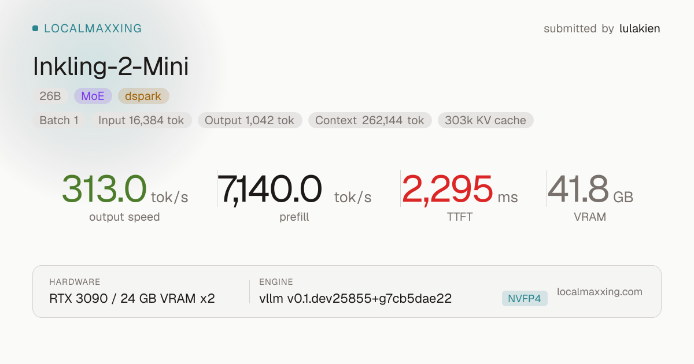
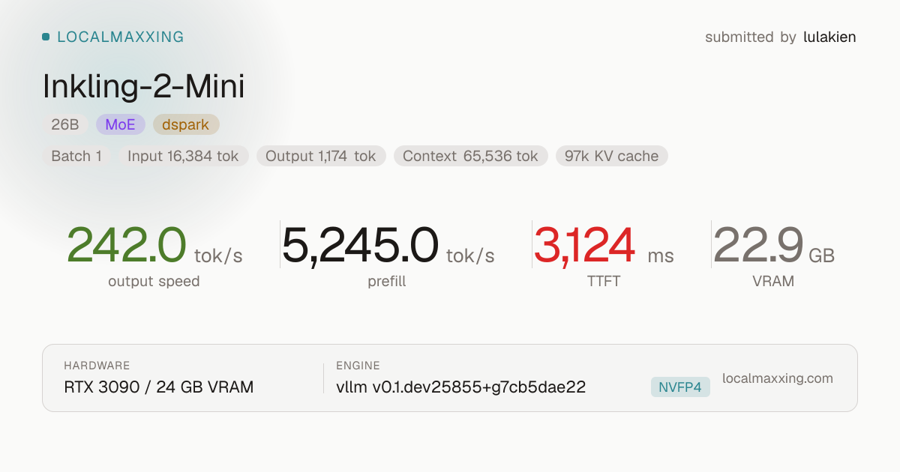

# Inkling 2 Mini on RTX 3090s: a vLLM recipe for 1 or 2 consumer Ampere GPUs

Serve [`thinkingmachines/Inkling-2-Mini`](https://huggingface.co/thinkingmachines/Inkling-2-Mini) on **one RTX 3090
(64K or 128K context)** or **two RTX 3090s (262K context)**, PCIe only, no NVLink, no P2P, power-capped at 280 W,
with the shipped checkpoint unchanged.

The official `vllm/vllm-openai:inkling-2-mini` image only supports Hopper/Blackwell. This repo has small file
overlays (mounted read-only over that image, nothing rebuilt) that make it run on sm_86. A second set of overlays
makes it fast there. It also has the launchers, the tests behind every number below, and the raw results.
**No model weights are included.**

## Results

<p>


</p>

Submitted to [LocalMaxxing](https://www.localmaxxing.com/en/models/thinkingmachines/Inkling-2-Mini). Its VRAM field
is the sum across GPUs (the 2-GPU card's 41.8 GB should read 40.8 GiB).

Same machine and checkpoint for every column. Batch 1 unless noted. Temp 0, reasoning effort "low" for decode.

| | 2 GPUs (`launch/2gpu.sh`) | 1 GPU, 64K (`launch/1gpu.sh`) | 1 GPU, 128K (`PROFILE=128k`) |
|---|---|---|---|
| max context / KV pool | 262,144 / 302,534 tok | 65,536 / 97,150 tok | 131,072 / 136,144 tok |
| decode tok/s: code / explanation / story | **313 / 166 / 126** | **242 / 130 / 97** | **242 / 130 / 97** |
| decode step (DSpark k=7) | 13.7-14.2 ms | 17.8-18.7 ms | 17.8-18.7 ms |
| prefill tok/s at 2K / 16K / 64K | 7,480 / 7,140 / 6,280 | 5,700 / 5,250 / 4,390 (61K) | 4,690 / 4,430 / 3,530 |
| prefill, near max context | 4,270 tok/s (254K in 59 s) | 4,390 tok/s (61K in 14 s) | 2,810 tok/s (127K in 45 s) |
| agent turn: 13K prompt sharing a prefix with the previous one | 0.12 s (cold 1.9 s) | 0.14 s (cold 2.5 s) | 0.17 s (cold 3.0 s) |
| 2 / 4 / 8 concurrent streams, total tok/s | 260 / 339 / 445 | 192 / 231 / - | 185 / 258 / - |
| needle in haystack (5% and 90% depth) | 255K: both found | 62.5K: both found | 128K: both found |
| MMLU, 57 subjects x 20, letter logits | 911 / 1140 (79.9%) | 912 / 1140 (80.0%) | 912 / 1140 (80.0%) |
| OpenAI API checks (`tests/api_smoke.py`) | 9/9 (+ image 10/10 with `MM=1`) | 9/9 | 9/9 |
| temp-0 run-to-run determinism | 8/8 identical | 8/8 | 8/8 |
| power while busy / max temp / peak VRAM | 277 W / 72 C / 21.0 GB per card | 276 W / 67 C / 23.4 GB | 277 W / 67 C / 23.4 GB |
| boot (compile cache warm / first ever) | 40 s / 125 s, + 6-14 s warm-up | 35 s | 35 s |

Decode speed depends on the text because speculative decoding (DSpark, the model's own drafter) accepts more
tokens on predictable text: about 4.5 tokens per step on code, 2.4 on technical prose, 1.75 on stories.

What the speed overlays add, measured on 2 GPUs (`results/2gpu_port_only`, which has only the overlays needed to
run, with every speed switch off):

| | port only | this recipe |
|---|---|---|
| decode, single stream | 109 tok/s (no speculation) | 313 / 166 / 126 tok/s (2.9x / 1.5x / 1.15x) |
| prefill 16K / 254K | 6,290 tok/s / 69.5 s | 7,140 tok/s / 59.4 s (+13.5% / -15%) |
| MMLU | 908 | 911 |

Serving many users at once? Speculation stops paying off at about 4 concurrent streams. With `SPEC=0` (2 GPUs):
single stream 130 tok/s, and 2 / 4 / 8 streams give 207 / 348 / **557** tok/s total, versus 260 / 339 / 445 with
speculation on.

## Quick start

Requirements: Linux, Docker with the NVIDIA Container Toolkit, an NVIDIA driver that supports CUDA 13
(tested on 620.73), RTX 3090(s) **with no display attached** (the single-GPU profiles use the whole 24 GB),
about 20 GB of disk for the model and 36 GB for the image.

```bash
git clone https://github.com/lulakien/inkling2-mini-3090-recipe && cd inkling2-mini-3090-recipe
hf download thinkingmachines/Inkling-2-Mini --revision ed40e7da625f594fc9c4990f5f66be24873c22d7 \
  --local-dir ~/models/Inkling-2-Mini
. launch/image.env && docker pull "$IMAGE"

bash launch/2gpu.sh                    # two GPUs, 262K context
bash launch/1gpu.sh                    # one GPU (GPU=0|1), 64K context
PROFILE=128k bash launch/1gpu.sh       # one GPU, 128K context, ~15% slower prefill
```

The server listens on `http://127.0.0.1:8000/v1` and the model name is `inkling-2-mini`. Stop it with
`docker stop inkling2` (2 GPUs) or `docker stop inkling2-1gpu`.
`MODEL_DIR`, `PORT`, `NAME`, `MAXLEN`, `MAXSEQS` and every switch in the `launch/serve.sh` header can be overridden
from the environment. To run two single-GPU servers at once, give each its own card, port and name:
`GPU=1 PORT=8001 NAME=inkling2-gpu1 bash launch/1gpu.sh`.

Reasoning: pass `"reasoning_effort": "none" | "low" | "medium" | "high"` (top level or in
`chat_template_kwargs`). Reasoning comes back in `message.reasoning`, the answer in `message.content`. Tool calling
(`--tool-call-parser inkling`) and JSON-schema `response_format` work (see `results/*/api_smoke.json`).

## Reproduce the numbers

```bash
bash tools/fetch_haystack.sh                         # needle-test text, copied out of the pinned image
LABEL=2gpu MAXCTX=262144 bash tests/run_suite.sh     # against a running 2gpu.sh server (~15 min)
NAME=inkling2-1gpu LABEL=1gpu_64k MAXCTX=65536 bash tests/run_suite.sh
bash tests/kernels/run.sh                            # bit-exactness of the two new prefill kernels (stop the server first)
```

| test | what it checks |
|---|---|
| `tests/api_smoke.py` | chat, streaming with usage, reasoning split, tool call + tool-result turn, JSON-schema output, `/v1/completions` logprobs, prefix-cache hit, temp-0 determinism, stop sequences, image input (`--image`, needs `MM=1`) |
| `tests/spec_bench.py` | single-stream decode speed and DSpark acceptance on code / explanation / story, temp 0 and 0.6 |
| `tests/prefill_ttft.py` | cold prefill throughput, 2K to near max context (random token ids, so no cache hits) |
| `tests/prefix_midprobe.py` | agent-style turns: same 13K prefix, different user message |
| `tests/concurrency.py` | total and per-stream throughput with 1-8 concurrent streams |
| `tests/needle.py` | find a planted line in a long code haystack at 5% and 90% depth, near max context |
| `tests/greedy_check.py` | temp-0 outputs identical across runs (8 prompts) |
| `tests/mmlu_letters.py` | MMLU 57 subjects x 20 questions, letter logits, sequential (`tests/data`, MIT-licensed MMLU) |
| `tests/kernels/` | parallel MoE align (35 cases) and 2-pass attn_res (72 cases) vs the stock kernels, `torch.equal` |
| `tools/gpu_summary.py`, `tools/gemm_tflops.py` | power/temp/VRAM from the suite's 1 Hz log; sustained BF16 GEMM rate (unlock check) |

Raw JSON for every run is in `results/`. Run-to-run variation is about 1-2% for prefill and decode step time.
Decode tok/s also moves with draft acceptance at temp 0.6.

## What is in the recipe

Details, profiles and rejected ideas: [`docs/NOTES.md`](docs/NOTES.md). Each overlay has a diff against the stock
file in `patches/diffs/`.

| piece | effect |
|---|---|
| **sm_86 port**: minimum capability, FA2 vision attention, Triton fallbacks for `conv_mix` / `short_conv`, no TMA, Triton MoE align, unfused embedding, portable drafter KV writes, griddepcontrol/PDL off | runs at all. Three of the stock kernels exist only for sm_100 and **fail silently** on Ampere (garbage MoE routing) |
| DSpark speculative decoding, k=7 (the drafter ships in the checkpoint) | decode 2-3x on code |
| host-memory TP2 all-reduce / all-gather for small tensors (no P2P on GeForce; ~12 us vs 31 us NCCL, bit-identical) | decode step -1.5 ms |
| split-K skinny GEMM for the loop controllers and dynamic conv taps (cuBLAS picks 6-CTA kernels at 2-16 rows) | decode |
| int8 per-channel weights (own Triton kernel) for attention qkvr, LM head, Markov head, drafter layers; experts and `wo_ud` untouched | decode ~8%, frees VRAM; MMLU 911 vs 908 in bf16 |
| row-piece layer tail on the copy engines (prefill all-reduce overlapped with expert GEMMs) | prefill +6%, 254K -9% |
| split-KV full attention for long prompts | 254K -9% |
| parallel MoE align, 2-pass attn_res (bit-identical) | prefill +3.4% (1 GPU), +7.5% (2 GPUs) |
| prefix-cache retention every 64 tokens | prefix hits when a new prompt diverges mid-message |
| single GPU: W8 quantized at load, GMU 1.0 + 512 MiB KV margin, chunked prompt-logprob warm-up, input embedding in pinned host memory, `--no-async-scheduling` | context on one card: 3.7K -> 64K / 128K tokens |
| persistent Triton/inductor cache + post-boot warm-up | boot 90 -> 40 s, no compile stall on the first request |

### Why one GPU can hold 128K

vLLM's KV planner reserves room in every sliding-window and short-conv cache for the tokens in flight. With async
scheduling that is two prefill chunks per cache. The model has 12 such caches, so this reserve took 2.36 GiB per
request at 64K, more than 64K tokens of full attention take (2.25 GiB). `--no-async-scheduling` halves it, with
no measurable speed cost (A/B: decode 243 vs 242 tok/s, prefill 5.28K vs 5.29K tok/s). The 128K profile also halves
the chunk size, which is where its prefill cost comes from.

## Test machine

| | |
|---|---|
| GPUs | 2x NVIDIA GeForce RTX 3090 24 GB (GA102, VBIOS 94.02.42.00.B4), power limit 280 W each (stock 350 W) |
| GPU links | PCIe 4.0 x8 / x8, no NVLink, no P2P (`nvidia-smi topo`: PHB) |
| GPU firmware mod | [gpu-unlock](https://github.com/Zagitta/gpu-unlock) active on both cards (see below) |
| display | on the CPU's integrated Radeon graphics; both 3090s headless |
| CPU | AMD Ryzen 7 9700X (8 cores / 16 threads, Zen 5) |
| board | ASUS ProArt B850-CREATOR WIFI NEO (BIOS 1103) |
| RAM | 64 GB DDR5 |
| storage | Samsung 990 PRO 1 TB (models), WD Blue SN5000 1 TB |
| OS | CachyOS, Linux 7.3.5-2-cachyos, NVIDIA driver 620.73.04 (open kernel module) |
| container | Docker 29.10.0, NVIDIA Container Toolkit 1.20.1 |
| image | `vllm/vllm-openai:inkling-2-mini` @ `sha256:c2dc759f...` (vLLM 0.1.dev25855+g7cb5dae22, PyTorch 2.14.0+cu130, Triton 3.8.0, Python 3.14) |
| model | `thinkingmachines/Inkling-2-Mini` @ `ed40e7da625f594fc9c4990f5f66be24873c22d7` (Apache-2.0) |

### gpu-unlock

GeForce Ampere cards run BF16/FP16 tensor-core math with FP32 accumulation at half rate. Zagitta's
[gpu-unlock](https://github.com/Zagitta/gpu-unlock) kernel module lifts that limit at boot. Prefill uses exactly that
math (Humming W4A16 expert GEMMs, bf16 attention and dense GEMMs), so **the prefill numbers above depend on it**.
On the same machine with the earlier Qwen3.8-27B recipe, the unlock gave +37% prefill. Decode is memory-bandwidth
bound and does not change. With the unlock, these cards sustain 91.5 TFLOPS dense BF16 at 280 W
(`results/kernels/gemm_tflops.txt`); a stock 3090 is rated for 71 at boost clocks. Install notes for this machine
are in [`gpu-unlock/`](gpu-unlock/README.md). It is third-party software that reprograms the GPU: read its README
first.

## Limitations and known issues

- **Tied to one image build.** Every overlay replaces a whole file of that exact build (vLLM `g7cb5dae22`).
  Pull by digest (`launch/image.env`). A newer `:inkling-2-mini` tag will probably need the patches rebased.
  `patches/diffs/` shows every change.
- **Tested only on RTX 3090 (sm_86).** Other 24 GB+ Ampere cards (3090 Ti, A5000, A6000) should behave the same
  but are untested. Ada (sm_89) is untested. One GPU needs 24 GB: the weights alone take 16.5 GiB.
- **The GPUs must be headless for the single-GPU profiles.** They allocate the whole card (GMU 1.0, 512 MiB margin).
  A desktop or a game on the same card makes boot fail or the server run out of memory under load. Shared cards are
  untested (try a smaller `MAXLEN` and `GMU` below 1.0). Another process using the GPU (even one that doesn't show in `nvidia-smi`, such as a
  game) also slows every number here.
- **Tuned for one user.** At 4+ concurrent streams use `SPEC=0`. The KV pool is shared: on one GPU, two requests
  can't both use 64K.
- **Single-GPU long prompts are slower:** the 128K profile uses 512-token prefill chunks (-15% prefill).
  Lowering `KV_MARGIN_MB` below 512 boots but runs out of memory on the first long prefill. Do not.
- **Reasoning cannot be fully turned off** (model behaviour, see the model card): even `reasoning_effort: "none"`
  writes a short reasoning block. Leave room for it in `max_tokens`. Structured output applies after it.
- **Vision** (`MM=1`) is smoke-tested on 2 GPUs only (one image, correct answer; KV pool 284K tokens). It is
  untested on one GPU and with video. The default is text-only (`--language-model-only`).
- **KV cache is bf16.** The image's FP8-KV path needs sm_89+.
- **int8 weights** (attention qkvr, LM head, Markov head, drafter) are a deliberate weight change. MMLU and the
  needle tests show no loss (911 vs 908 bf16), but outputs differ slightly from bf16. `W8=` restores bf16
  (measured on 2 GPUs; on one GPU it leaves less room for context, untested).
- **Speculative decoding at temp 0 is not token-identical to plain greedy decoding** (bf16 batch-shape numerics). It is
  deterministic run to run (8/8). Quality is judged by task metrics, not token identity.
- **Prefix cache:** hits need 64-token-aligned shared prefixes. The retention interval stores extra blocks per cached
  prefix. With many distinct long prefixes, use `EXTRA="--prefix-cache-retention-interval 2048"`.
- **MMLU here is a 1,140-question subset** scored by letter logits. It is a regression gate, not a reproduction of the
  model card.
- Numbers are at a 280 W cap with gpu-unlock. Prefill is power-limited: 350 W gives more, decode stays the same.
  2-GPU prefill is also limited by PCIe x8/x8 all-reduces.
- **The first boot compiles kernels (~2 min).** They are cached in `~/.cache/inkling2-vllm` (`CACHE_DIR`). Delete it
  after changing patches.

## Layout

```
launch/     serve.sh (all switches), 2gpu.sh, 1gpu.sh (PROFILE=64k|128k), image.env (pinned image digest)
patches/    files mounted over the image (+ hostar/ host-memory collectives, diffs/ vs the stock files)
tests/      run_suite.sh and the tests above, data/ (MMLU subset), kernels/ (bit-exactness harnesses)
tools/      fetch_haystack.sh, gpu_summary.py, gemm_tflops.py
results/    raw JSON per profile: 2gpu, 1gpu_64k, 1gpu_128k, 2gpu_port_only, 2gpu_nospec, 2gpu_vision, kernels
docs/       NOTES.md: engineering notes, where the time goes, what was tried and rejected
gpu-unlock/ how this machine keeps the unlock boot entry current (CachyOS + Limine specific)
```

## License

Apache-2.0. Most patched files are derived from vLLM (Apache-2.0) and two from Triton (MIT); their original
license headers are kept.
The MMLU subset in `tests/data` comes from [cais/mmlu](https://huggingface.co/datasets/cais/mmlu) (MIT).
